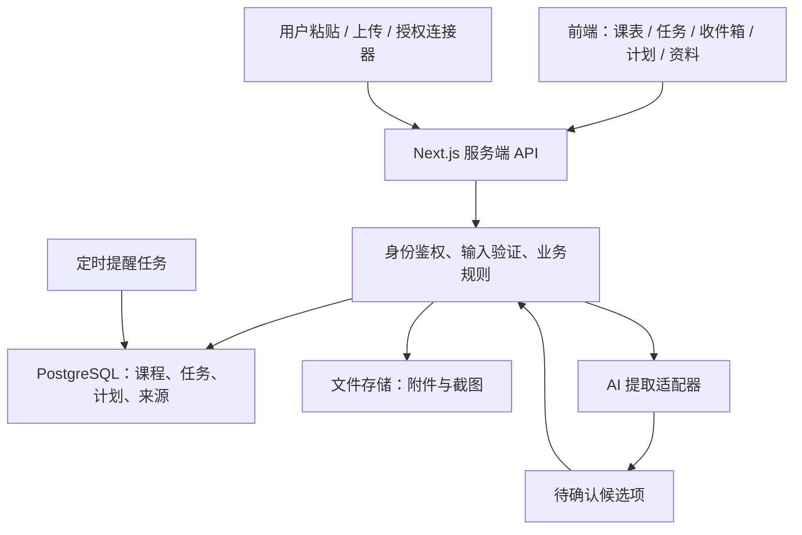

# AI Campus OS｜大学生 AI 工作台开发蓝图 v1.1

> 项目负责人：许鑫｜日期：2026-10-26｜状态：规划稿，尚未声称开发完成或验证用户需求。
>
> 目标：先解决个人与身边同学的课程事务管理问题；同时沉淀真实、可展示的全栈与 AI 应用开发经历；长期探索通用大学生产品。

## 0. 产品决策摘要

**一句话定位**：把散落在课表、课堂通知、聊天群和课程资料中的信息，整理成可确认、可执行、可追踪的个人学习计划。

**首个可验证闭环**：录入课表 → 创建或粘贴任务通知 → 识别课程、任务和截止时间 → 用户确认 → 进入待办 → 安排可用时段 → 提醒、完成和归档。

**必须坚持的原则**：

1. 先完成可靠的任务与课表系统，后加入 AI 与平台对接。
2. AI 提取结果作为**候选项**，未经用户确认不能改变重要任务；自动提交问卷或代填信息更须逐项核对和明确授权。
3. 普通微信聊天、学校教务系统及学习通接口能否读取，不能靠假设；先做用户主动分享、粘贴与上传的合法路径。
4. 课程时间与“可灵活利用的时段”是两回事：不能自动把所有水课变为无课，尊重签到、实验、考试等硬约束。
5. 切忌界面全是假按钮、数据全是静态 Demo；每个阶段明确标注哪些是真功能。

## 1. 用户与场景

### 1.1 首批目标用户

- P0：自己（河北工程大学软件工程专业大二），已有学习通、课程群、课表、个人计划与考试安排。
- P1：同班/同学院 3–5 位愿意提供反馈的同学。
- P2：不同院系或学校学生，用来验证产品的通用性。

### 1.2 要解决的真实痛点

| 场景 | 现在的困难 | 期望的结果 |
| --- | --- | --- |
| 教师在 QQ/微信群通知作业 | 聊天信息很快被淹没 | 提取任务、所属课程、截止时间、附件与来源 |
| 学习通/课程群散落资料 | 文件难找，聊天文件可能过期 | 每门课统一归档，支持检索及来源追踪 |
| 课表、空闲时间、个人学习目标分开 | 不知道什么时候做什么 | 按空闲时段和任务重要度提供可修改排程 |
| 作业与其他临时事务 | 忘记截止日期或排得太晚 | 多层提醒、逾期状态与主动重新安排 |
| 期末复习 | 不清楚一学期重点和材料 | 按课程生成带出处的资料清单与复习提纲 |
| 问卷、信息收集 | 容易漏填、重复填 | 识别为待办，未来支持人工确认的表单辅助 |

## 2. 功能优先级与边界

| 模块 | M0 界面验证 | M1 真正可用 MVP | M2 AI 闭环 | M3 增强 | M4 远期 |
| --- | --- | --- | --- | --- | --- |
| 课表 | 静态/本地编辑 | 课程、学期、周次、时间段 | OCR/截图辅助导入 | 课程时间例外处理 | 教务授权同步 |
| 任务 | 本地增删改查 | 登录后的持久化 CRUD、筛选、状态 | 通知提取候选任务 | 去重、来源关联、重复任务 | 协同任务 |
| 截止提醒 | 可视化 | 应用内提醒与即将到期列表 | 智能提醒建议 | 邮件/推送（授权） | 跨端通知 |
| 日程 | 静态时间轴 | 手动计划时间块 | 规则式推荐排程 | 自动冲突调整 | 适应个性化偏好 |
| 通知收集 | 示例数据 | 手动粘贴/截图上传 | AI 解析、复核队列 | QQ 官方机器人接入（前提满足） | 其他经授权平台对接 |
| 课程资料 | 列表占位 | 上传、分类、检索文件名 | 提取内容和关联任务 | 带来源的问答/期末提纲 | 多人资料库 |
| 用户系统 | 无 | 个人登录、隔离数据 | 隐私与额度设置 | 数据导出/删除 | 多用户协作 |
| 个人目标 | 无 | 可先作普通待办分类 | 与空余时间关联 | 六级、编程、蓝桥杯等目标管理 | 全领域个人助理 |

**本次不做**：独立训练大模型、无人确认的群聊监控、自动代签到、破解接口、绕过学校权限、未经确认的信息填报、微服务/Kubernetes、移动原生 App、复杂社交系统。

## 3. 用户页面（信息架构）

1. **首页 `/dashboard`**：今日日期与教学周；今天课程时间线；最紧急的 3–5 项任务；今天可用时间；通知待审核数；一键添加。
2. **课表 `/timetable`**：周视图，切换教学周；课程地点、教师、时间段、单双周；节假日/调课；“本节课可安排自习”是手动偏好而非无条件空闲。
3. **任务 `/tasks`**：全部/今天/本周/逾期/已完成；所属课程、截止日期、预计耗时、优先级；新增、编辑、删除、完成、恢复；可查看通知来源。
4. **收件箱 `/inbox`**：粘贴群消息/课程通知、上传截图 → AI 提取预览 → 编辑不确定字段 → 确认保存；拒绝/忽略；重复提醒。
5. **计划 `/planner`**：日历和时间块，展示课程占用与个人计划；建议时间块必须经用户确认；可拖动或手工修改。
6. **课程资料 `/courses/[id]`**：该课任务、文件、通知、复习资料、重要链接；文件预览/下载；按资料来源标注。
7. **设置 `/settings`**：学期时间、教学周起始、时区、上课节次、工作时段、提醒偏好、数据删除导出、AI 服务配置与隐私说明。

UI 原则：简体中文默认，桌面浏览器和手机优先适配；浅色干净、克制的蓝/青绿色强调色；任务重点是效率与清晰度，不做花哨的「AI 科幻面板」。所有列表均有加载中、空数据、出错、保存成功四种状态。移动端导航不超过五个主入口。

## 4. 技术总体方案

### 4.1 实现路径

- **M0（本项目默认）**：直接用 Next.js + TypeScript + Tailwind 制作只有本地数据的可点击课表+任务页面，**无登录、无数据库、无 AI**。这样进入 M1 时可以在同一代码库演进，避免丢弃演示原型。若只是单独练习基础语法，才另做纯 HTML/CSS/JavaScript 小练习。
- **M1 以后推荐统一栈**：TypeScript、React、Next.js App Router、Tailwind CSS；PostgreSQL（Supabase）、Supabase Auth、Supabase Storage；Next.js 服务端 Route Handlers；Git/GitHub、Vercel。
- **AI**：由后端调用模型 API，结构化结果校验（JSON Schema/Zod），保留原始来源与置信度；不把 API Key 下发浏览器。模型供应商封装为适配器，便于以后替换。
- **测试**：Vitest（单元）、Playwright（核心流程端到端）、数据库迁移与 RLS 权限测试。
- **提醒/定时**：先做用户访问时的应用内提醒；需要真正后台定时推送时接入受控 Cron/作业系统，并保证幂等。
- **部署**：开发本地 `.env.local` + 云端 Secrets；预览环境和正式环境隔离。

### 4.2 逻辑架构



### 4.3 为什么先单体而不是微服务

项目开发初期只有一个主要开发者，用同一个 Web 项目承载 UI、服务端接口和业务规则，调试、部署、权限、数据模型都更容易学习和管理。模块内部仍要分层，未来只在有真实性能/团队协作需求时拆服务。

### 4.4 推荐仓库结构（进入 M1 后）

```text
ai-campus-os/
  README.md
  AGENTS.md
  CHANGELOG.md
  LEARNING_LOG.md
  .github/
    ISSUE_TEMPLATE/
    PULL_REQUEST_TEMPLATE.md
    workflows/ci.yml        # M1 起按需加入
  docs/
    PRD.md
    architecture.md
    data-model.md
    milestones.md
    decisions.md
    devlog/                 # 周报：真实进展和反思
    case-study.md           # 有真实成果后编写简历案例
  src/
    app/
      (auth)/login/
      (app)/dashboard/
      (app)/timetable/
      (app)/tasks/
      (app)/inbox/
      (app)/planner/
      (app)/courses/[id]/
      (app)/settings/
      api/
    components/
      ui/
      timetable/
      tasks/
      inbox/
      planner/
    features/
      courses/
      tasks/
      notices/
      scheduling/
      materials/
    lib/
      supabase/
      validation/
      dates/
      ai/
  supabase/
    migrations/
    tests/
  tests/
    unit/
    e2e/
  .env.example
```

不要为了跟目录树一致而预先建大量空文件；随着功能新增。

## 5. 核心数据模型

| 表 | 主要字段 | 说明 |
| --- | --- | --- |
| `profiles` | `id`, `timezone`, `display_name`, `created_at` | 与 Auth 用户一一对应，默认 `Asia/Shanghai` |
| `semesters` | `id`, `user_id`, `name`, `start_date`, `end_date`, `week_start_day` | 教学周基准，处理学期切换 |
| `courses` | `id`, `user_id`, `semester_id`, `name`, `teacher`, `color`, `notes` | 每门课归属用户、学期 |
| `class_sessions` | `id`, `course_id`, `weekday`, `start_time`, `end_time`, `weeks`, `location`, `session_type`, `flexible_study_allowed` | 可表达单双周、课程地点、可选自习时段 |
| `schedule_exceptions` | `id`, `course_id`, `date`, `action`, `new_start`, `new_end` | 调课、停课、补课与单次变化 |
| `tasks` | `id`, `user_id`, `course_id`, `title`, `description`, `due_at`, `estimated_minutes`, `priority`, `status`, `source_id`, `created_at`, `updated_at` | 核心实体；截止时间可为空表示需确认 |
| `source_items` | `id`, `user_id`, `source_type`, `origin_label`, `source_time`, `raw_text`, `file_id`, `content_hash` | 通知/群消息/截图来源，便于追溯与去重 |
| `extraction_candidates` | `id`, `user_id`, `source_id`, `payload`, `confidence`, `status`, `reviewed_at` | AI 候选项与用户审核状态 |
| `files` | `id`, `user_id`, `course_id`, `storage_path`, `name`, `mime_type`, `size_bytes`, `uploaded_at` | 上传附件元数据，真实文件存私有对象存储 |
| `time_blocks` | `id`, `user_id`, `task_id`, `start_at`, `end_at`, `status`, `origin` | 实际安排的学习时间块，不等于课程表条目 |
| `reminders` | `id`, `user_id`, `task_id`, `scheduled_at`, `channel`, `status`, `dedupe_key` | 提醒时间、发送结果、幂等键 |
| `user_preferences` | `user_id`, `study_windows`, `break_minutes`, `max_daily_minutes`, `notification_settings` | 排程配置和通知偏好 |
| `integration_connections`（M3） | `id`, `user_id`, `provider`, `status`, `scopes`, `last_synced_at` | 经授权外部连接信息；密钥单独加密保存 |

数据库要求：外键、唯一约束、检查约束、必要索引；所有个人数据包含所有者标识或可通过归属关系安全校验。每张含个人数据的表启用 Row Level Security；**永远测试 A 用户不能读取/修改 B 用户数据**。删除课程时关联任务和文件采用明确的保留或确认删除策略，不盲目级联。

### 5.1 关键字段约定

- 时间：存储 UTC 时间戳，按用户时区显示；学期日期、单双周和上课时段单独存本地日期/时间。
- 任务状态：`todo / in_progress / done / canceled`；逾期是由 `due_at < now && status != done` 推导的视图，非必须独立状态。
- 优先级：`low / medium / high`，加上截止期影响排序，但不互相覆盖。
- AI 来源：保留原消息片段与人工修改痕迹；删除来源时按隐私约定处理关联任务。
- 重复任务：优先匹配同一课程、相近标题/截止时间、来源哈希；提示用户，不静默合并。

## 6. 核心业务流程

### 6.1 手动添加任务（M1）

用户选课程（可空）→ 输入标题、截止时间、预计耗时、优先级 → 前端验证 → 服务端再次验证身份与数据 → 写入数据库 → 返回任务 → 首页与任务列表同步。

**异常处理**：无截止时间可保存为“待定”；时间早于当前时显示警告但允许录入已逾期作业；无网络时提示重试，禁止假装保存成功。

### 6.2 粘贴群通知 → AI 提取（M2）

**示例**：

> “数据库作业第 3 次，周五晚上八点前在学习通提交；下周二上课带实验报告。”

1. 用户在收件箱主动粘贴，确认是否包含其他人的隐私信息。
2. 系统保存来源、接收时间、文本哈希，做好长度限制和去重。
3. 后端将文本、用户时区、该通知的真实发送日期、已知课程列表交给 AI。
4. AI 输出候选任务结构；相对时间必须依据来源日期解释，无法确定年份/“周五”指向时明确标记待确认。
5. 使用 Schema 校验，检查课程归属、日期格式、内容长度、意外 URL/恶意指令；不得仅凭“模型给了 JSON”就直接入库。
6. UI 显示每条候选任务：标题、课程、截止时间、来源原文、低置信字段。用户可修改、删除、确认。
7. 确认后按正常任务接口保存；源消息与任务建立关联；已识别但未确认的项不进入正式待办。

候选数据示意：

```json
{
  "items": [
    {
      "title": "提交数据库第 3 次作业",
      "course_name": "数据库",
      "due_at": null,
      "due_text": "周五晚上八点前",
      "type": "assignment",
      "confidence": 0.81,
      "requires_confirmation": true,
      "source_excerpt": "周五晚上八点前在学习通提交"
    }
  ]
}
```

`due_at: null` 只是示例在**未给消息具体发送日期**时不能确定绝对日期，不代表有日期时仍应输出 null。置信分只能作为辅助排序，不可当作真实概率保证。

### 6.3 排程推荐（M2：规则优先）

输入：固定课程、用户声明不可用/可灵活的时间、任务截止时间与耗时、任务优先级、用户习惯、已排时间块。

规则：

1. 计算每日可用区间，硬性课程/睡眠/已预约时间先占用。
2. 处理时段跨天、单双周、调课例外与最低休息间隔。
3. 任务按“截止接近程度 + 优先级 + 所需时长”生成建议顺序；长任务切分为合理时间块。
4. 截止时间前预留缓冲，严格不安排在截止后；做不到时诚实提示“时间不足/冲突”，让用户决定。
5. 用户确认后才创建 `time_blocks`；任务完成、延期、课程变化后重新建议，不覆盖用户手动固定的计划。

**算法演进**：先确定性贪心规则 + 冲突检测；真实用户试用后再考虑约束求解。AI 可解释与建议，但日历冲突必须由程序验证。

### 6.4 文件与复习（M3）

用户上传 PDF/Word/PPT/图片 → 文件大小与类型校验 → 私有存储 → 后台抽取文本/OCR（按需）→ 归属课程、标注来源 → 搜索与预览。后续可对课程材料生成“考试重点/复习提纲”，每条总结必须显示可追溯文件或页码，找不到依据应说不知道；学校与同学的版权和隐私需获得授权。

## 7. 外部接入可行性与分层

| 来源 | 初期安全可行的方式 | 后期探索 | 主要前提 |
| --- | --- | --- | --- |
| 普通微信群 | 用户复制/转发内容、手动上传截图或导出的可授权资料 | 如果平台将来提供可用授权接口再接入 | 不能假定可直接读取个人群聊天记录 |
| QQ 群 | 用户粘贴/截图 | QQ 官方机器人事件与回调 | 群允许加入机器人；应用具备对应消息权限；校验事件签名、处理重复事件 |
| 学习通/超星 | 用户手动录入/分享资料/上传通知 | 超星开放平台申请/授权 | 所需接口、账号资质、课程数据访问范围及学校授权实际可用 |
| 学校课表 | 手动创建，后续截图 OCR | 有官方接口再做授权同步 | 学校政策、账号权限与接口可用性 |
| 文件/图片 | 用户主动上传 | 批量导入、归档和检索 | 大小、权限、解析失败与生命周期管理 |

每个平台抽象一个 `SourceAdapter`：`authorize`（可选）、`ingest`、`normalize`、`dedupe`、`disconnect`。不要把 QQ 消息格式直接写进核心任务表。对外部数据使用最小权限、来源标记、可断开连接、可删除内容；绝不索要或储存明文平台账号密码。

## 8. 接口边界（建议，开发时可微调）

| 路由 | 方法 | 用途 | 里程碑 |
| --- | --- | --- | --- |
| `/api/courses` | GET / POST | 列表、创建课程 | M1 |
| `/api/courses/[id]` | PATCH / DELETE | 修改、删除课程 | M1 |
| `/api/class-sessions` | GET / POST | 课程时间段 | M1 |
| `/api/tasks` | GET / POST | 列表、筛选、创建任务 | M1 |
| `/api/tasks/[id]` | GET / PATCH / DELETE | 编辑、状态更新、删除 | M1 |
| `/api/source-items` | POST | 用户提交通知文本/截图 | M2 |
| `/api/extractions` | POST | 请求分析来源 | M2 |
| `/api/extractions/[id]/review` | POST | 人工确认/拒绝候选结果 | M2 |
| `/api/planner/suggest` | POST | 根据空闲时间生成候选块 | M2 |
| `/api/time-blocks` | GET / POST / PATCH | 确认和编辑排程 | M2 |
| `/api/files` | GET / POST | 授权上传和文件列表 | M3 |
| `/api/integrations/qq/events` | POST | 验签后接收官方 QQ 回调 | M3 |

所有写接口必须验证登录身份、数据归属、请求体、文件类型和速率/配额；仅前端隐藏按钮不算权限控制。必要的服务端代码和数据库策略一同测试。

## 9. 质量、安全和成本约束

- **安全**：客户端不可见服务端 API 密钥；严格 RLS；参数校验与上传类型检查；第三方回调验签；防止提示注入和来源文本诱导执行指令；避免公开用户材料；HTTPS。
- **隐私**：收集最少数据；用户明确知道哪些文本被送往 AI；群消息/同学个人资料需脱敏或经过允许；允许删除来源、任务、附件与账号数据；日志不记录隐私原文或凭证。
- **鲁棒性**：AI 超时、网络失败、乱码、OCR 错误、无对应课程、时间模糊、重复事件均应有可恢复的失败状态。
- **性能**：列表分页/筛选；AI 提取异步反馈；大型文件不要阻塞主请求。目标先服务个人和小范围测试，不盲目设计百万用户并发。
- **费用**：模型请求做字数上限、频率限制、缓存/去重及用户可见错误；储存文件设置大小上限与保留策略；云服务以免费/低成本层验证为主，实际套餐和价格上线前再核对。
- **可观察性**：记录请求 ID、错误码、作业状态、耗时和匿名用量；不在日志打印内容全文。
- **备份**：建立迁移文件和数据库备份/导出策略，并测试恢复。

## 10. 分阶段开发计划与验收

### M0｜可点击的静态原型（不接后端）

交付：课表周视图、任务 CRUD、本地持久化（例如 `localStorage`）、首页布局、响应式样式和示例数据；明确标注本地演示版。

验收：刷新后本地任务仍在；添加、修改、完成、删除都真实生效；桌面和手机均可用；没有伪造的“AI 已分析”按钮。只有这一阶段允许全部本地数据。

### M1｜可信赖的个人事务管理（真正 MVP）

交付：Next.js 工程、登录、数据库迁移、Supabase Auth/RLS、学期与课程、课表、任务 CRUD、即将截止列表、基础设置与部署。

验收：用 A/B 两个账号检查隔离；退出重登数据仍在；课程/任务变更即刻同步；跨周、单双周、过期任务正确；能够给 1 位同学真实试用。

### M2｜AI 通知转任务 + 规则排程（差异化演示）

交付：粘贴文字→AI 生成候选→人工审核→入库；来源追踪；去重预警；排程建议、冲突检测、确认时间块；应用内提醒。

验收：拿 20 条人工整理的不同通知做测试（含多任务、无截止时间、相对日期、噪声、重复与恶意指令）；每条确认后数据库正确、不确认不入库；永不默默捏造截止日期；时间块不会覆盖硬约束。

### M3｜文件与渠道接入

交付：文件上传/归档/检索、OCR 或文档提取、期末资料汇总；评估 QQ Bot 官方接入与超星授权接入。逐个加，不并行铺开。

验收：权限、删除、下载、重复导入与失败重试通过；只有获得平台条件后，才把“自动收集”标记已实现。

### M4｜产品化与验证

交付：真实用户访谈、反馈统计、数据导出/删除、性能优化、通知渠道、多校通用配置；后续再考虑协同、移动端或开放插件。

验收指标（先收集基线，不编造结果）：

- `首次完成任务录入率`：新用户能否独立完成至少一条任务。
- `通知提取确认率`：候选任务最终被用户接受的比例。
- `截止日期纠错率`：用户需要修改模型给出的截止时间的比例。
- `7 日留存/周活`：用户是否真的连续使用。
- `漏办任务主观反馈`：试用同学是否感觉减少遗漏。

## 11. Codex 的工作方式

**一次只给一个里程碑或一个可验收的小功能**，不要让 Codex 一次写完 M0–M4。每一阶段：先查看当前代码 → 提出变更计划 → 实现 → 自动测试 → 人工体验 → 提交 Git。

建议放在 `AGENTS.md` 的项目约定：

```md
# AI Campus OS — Codex collaboration rules
- Read docs/PRD.md and docs/milestones.md before implementation.
- Implement only the requested milestone. Do not silently add future modules.
- Use TypeScript for production code; avoid `any` without justification.
- All mutations must validate auth, ownership, and inputs on the server.
- AI output is untrusted. Never save extracted tasks without user confirmation.
- Date/time logic must handle Asia/Shanghai, semester weeks, and ambiguous dates.
- Do not fabricate integration capabilities, tests, screenshots, or completion status.
- Do not hard-code secrets or expose service credentials to the browser.
- Add or update tests for core rules and report what was actually run.
- Explain changed files, key design choices, remaining limitations and next steps.
- Prefer small changes that are easy for a beginner developer to review.
- For each feature, report the related Issue, changed files, test evidence, and learning points.
- Preserve meaningful Git history. Do not invent commits, metrics, tests or user feedback.
- Never push, merge, publish releases or change repository visibility without the user's instruction.
```

### 首次给 Codex 的提示词（M0）

```text
你是这个项目的全栈开发搭档。请先阅读项目根目录的 AI_Campus_OS_Blueprint_v1.md，并把它作为产品总规格。

这一次只实现 M0：中文大学生 AI 工作台的可点击前端原型。技术使用 Next.js App Router + TypeScript + Tailwind，但本轮不接任何服务端数据库。
1. 桌面和手机自适应，设计要专业、克制、清晰。
2. 包含首页、课表周视图和任务列表，课程和任务均能增删改查。
3. 使用本地存储保存数据；提供少量可修改的演示课程和任务。
4. 不添加登录、数据库、AI API、真实平台同步或假按钮。
5. 课表支持周切换，任务支持截止时间、优先级、课程关联和完成状态。
6. 给出启动命令、运行测试、实际完成项和下一步建议。

先向我展示你的实现方案与文件计划，再进行编码。分步完成并保证可以运行。
同时按本蓝图第 12 节的 GitHub 展示规范准备 README、Issue 建议、规范提交信息和本轮学习记录模板；不要擅自推送到远程仓库或公开数据。
```

### 进入 M1 时的提示词骨架

```text
本次从已完成且验收通过的 M0 出发，只推进 M1。
先检查当前代码与测试，再给出数据库 ER 草案、迁移方案、权限方案和文件变更清单。
使用 Next.js + TypeScript + Supabase Auth/PostgreSQL；落实真实任务与课程的登录后持久化。
建立 RLS、A/B 用户隔离测试、字段校验与示例环境变量文档。
不要提前接入 AI、QQ群、微信或学习通。每个小功能完成后运行测试并报告结果。
```

### 每轮开发结束后，许鑫应问的五个问题

1. 这轮具体解决了什么用户问题？
2. 哪些数据是真的持久化，哪些仅是模拟？
3. 这个功能最关键的函数、表和 API 在哪里？能用简单语言解释吗？
4. 你跑了哪些测试？有没有没有通过或未执行的测试？
5. 如果另一个账号、错误通知或断网出现，会发生什么？

## 12. GitHub 版本管理、公开迭代与个人能力证明

本节是每个开发里程碑都必须执行的工作流，而不是开发结束后才补的宣传材料。目标：让实习面试官、挑战营导师和潜在用户能同时看到**需求判断、本人参与的设计、真实代码、质量验证、迭代过程**。GitHub 的提交次数/绿格仅是活动信号，不能替代上述证据。

### 12.1 仓库定位与公开原则

- 仓库名建议 `ai-campus-os`，一套主代码库，不为漂亮的 GitHub 绿格创建空提交。
- **推荐在确认所有展示素材不含私人信息后，从 M0 开始公开仓库**，便于保留完整可见的演进史。如果暂时放不下真实数据，就只用虚构课程/任务及合成通知制作演示，私人测试数据严格放在未公开环境。
- `README.md` 必须说明：解决什么问题、当前版本有哪些真实功能、演示图/视频、技术栈、如何运行、项目架构、开发路线和已知限制。未实现功能单独放 `Roadmap`，禁止列入已实现功能。
- GitHub 项目页最终放在线 Demo 链接、版本列表与 60–90 秒的核心工作流演示视频；个人主页可置顶本仓库。
- 禁止提交 `.env.local`、模型 API Key、数据库密钥、Cookie、微信/QQ群原始消息、未授权的教务数据、同学姓名和联系方式。维护 `.gitignore`、`.env.example`；公开截图前人工检查个人信息。

### 12.2 最小工作流：一个功能形成一条证据链

```text
Issue（为什么做）
  ↓
需求与验收条件（做成什么样）
  ↓
feature 分支 + Codex 辅助实现（怎么做）
  ↓
许鑫理解、修改关键逻辑 + 测试（本人学到了什么）
  ↓
Pull Request（设计解释、截图、测试、风险）
  ↓
合并到 main → 更新 CHANGELOG → 按里程碑发布 Release
```

**轻量规则**：日常小修不用为形式创建很多冗余 PR；但每个重要功能至少保留一个 Issue、一段有意义的提交历史、验收/测试证据及一条开发日志。即使单人开发，也可用分支和 PR 展示问题分析、代码审查和技术选择。用户自己确认后再执行 Push/Merge/Release。

### 12.3 GitHub Issues 与 Projects

建一个 `AI Campus OS Roadmap` 看板，先用三列：`Todo` / `In Progress` / `Done`。标签建议：`feature`、`bug`、`docs`、`test`、`learning`、`M0`–`M4`。每个 Issue 不宜大到“完成 AI 工作台”，最好可以在一次或少量几次开发中验收。

Issue 示例：

```md
## #1 实现课程表周视图
用户问题：课表分散，难以查看今天课程与可用时间。
功能范围：显示本周课程；切换教学周；展示上课时间、地点；支持编辑演示数据。
不做：学校接口同步、AI 导入、真实账号登录。
验收标准：课程不重叠显示；周切换正常；刷新后本地修改仍存在；手机宽度可用。
学习目标：理解 React 组件、状态、事件与列表渲染。
测试证据：手动验收记录和截图；能够运行的自动化测试（若已建立）。
```

### 12.4 分支、提交和 PR 规范

- 分支：`feature/issue-1-timetable`、`fix/issue-12-date-parsing`、`docs/weekly-review`。
- 提交信息：`feat(timetable): add week navigation`、`fix(tasks): validate deadline input`、`test(planner): cover overlapping classes`，一句话说明实际修改。
- PR 说明包含：关联 Issue；本次解决的问题；核心实现思路；个人负责的设计/修改；运行的测试及结果；截图或短视频；已知风险；是否使用 AI 辅助。
- 不要为了提高提交数量把一个完整修改故意拆成几十个空洞提交；保留自然、清晰的开发历史。
- `main` 作为可运行主线。M1 起逐步使用 GitHub Actions 在 PR/Push 时运行 lint、类型检查、单元测试；是否可以合并，取决于实际测试结果。

### 12.5 版本发布与公开开发日志

| 阶段 | 建议 Release | 必须展示的事实证据 |
| --- | --- | --- |
| M0 | `v0.1.0` | 课表/任务演示、交互录像、README、首批 Issues |
| M1 | `v0.2.0` | 数据库设计、登录与账号隔离测试、可运行部署 |
| M2 | `v0.3.0` | AI 提取流程、至少 20 条多类型通知的真实测试统计、失败案例及修复 |
| M2 排程完成 | `v0.4.0` | 排程规则、冲突测试、前后版本效果 |
| 真实试用后 | `v1.0.0`（条件式目标） | 实际可用功能、匿名用户反馈、已知问题和后续路线 |

这些版本号是**拟定的发布目标**，并非已发布。每次 Release 都写真实的 Added/Changed/Fixed/Known issues，并关联 Issue/PR，方便查看版本差异。

每周日中午结合已有的 Human 3.0/学习复盘，整理一篇很短的 `docs/devlog/YYYY-MM-DD.md`：

1. 本周做成了什么（附提交/Issue/演示链接）？
2. 自己真正理解了哪些技术？
3. 本周自己改动或调试的关键代码是什么？
4. 遇到的主要 Bug 与解决过程是什么？
5. 下周选择哪一个最小可交付功能？

无需天天发长文章。开发当日用 `LEARNING_LOG.md` 写 3–5 行即可，周日汇总公开。记录本人尚不理解的部分，并在后续补上学习证据。

### 12.6 ChatGPT、Codex 与许鑫的职责边界

| 角色 | 负责什么 | 应留下的证明 |
| --- | --- | --- |
| 许鑫（产品与技术负责人） | 用户问题、需求取舍、核心方案选择、代码验收、亲自修改关键逻辑、用户访谈 | Issue 决策、本人解释、修改记录、测试/反馈 |
| ChatGPT（学习导师与审查） | 解释必要知识、提问、审查代码与设计、排错引导、复盘、面试模拟 | 学习日志、问题/答案、技术决策和待改清单 |
| Codex（实现搭档） | 在确定范围内编写/修改代码、补测试、生成文档初稿 | 实际 diff、测试结果、PR 的实现说明 |

每轮必须能回答：为什么选这个方案、数据如何流转、关键函数在哪里、如果失败会怎样、哪个部分是自己独立完成或修复的。对于数据库、API、AI 输出校验、日程冲突检测，至少做到**能读懂、能修改、能调试**。不要求每行 UI 样式都由本人手写。

### 12.7 简历与作品集取证

- 对外展示顺序：产品一句话介绍 → 60–90 秒 Demo → 架构图 → 关键技术问题/解决方案 → GitHub 迭代记录 → 测试与真实反馈。
- `docs/case-study.md` 记录 2–3 个技术案例，如相对日期识别、任务去重、单双周课程排程和跨用户权限。每个案例包括问题、尝试过的方案、最终设计、测试和不足。
- 从发布后开始统计真实指标：试用人数、每周活跃情况、通知提取确认率、日期纠错率、完成率、缺陷修复数量；说明统计口径，不虚构“效率提升 90%”之类的数据。
- 简历成果只引用已实现、有代码/演示/测试佐证的功能；计划中的平台自动连接、问卷代填等不写成已交付。面试时坦诚说明 AI 工具辅助范围，重点解释本人的需求判断、架构、逻辑与问题解决。
- 目标是形成可被追问的**真实项目经历**，而不是只增加仓库 Star 或 GitHub 贡献格数量。

### 12.8 每个里程碑的 GitHub 验收清单

- [ ] 相关 Issue 有明确验收条件与最终状态。
- [ ] 重要代码修改可在提交历史/PR 中定位，提交信息有意义。
- [ ] README 的“已实现功能”和当前版本一致；截图/演示是实际产品。
- [ ] 本轮测试有真实结果，失败测试与未实现部分没有被隐藏。
- [ ] `CHANGELOG.md` 与 Release（如果到版本节点）已同步。
- [ ] 本人 `LEARNING_LOG.md` 记录一个关键知识点和一个实际解决的问题。
- [ ] 无密钥、真实群消息或个人隐私数据进入公开仓库。

## 13. 立刻开始的执行清单

- [ ] 建立 GitHub 仓库 `ai-campus-os`；准备脱敏虚构数据后公开源码，若尚未清理则先保持私有。
- [ ] 把本蓝图保存到仓库根目录，后续逐步拆为 `docs/PRD.md`、`docs/data-model.md` 等。
- [ ] 编写 README（项目定位与**当前真实状态**）、`.gitignore`、`.env.example`、`LEARNING_LOG.md`、`CHANGELOG.md`。
- [ ] 创建 GitHub Projects 三列看板及第一个课表功能 Issue。
- [ ] 按默认路线建立 Next.js + TypeScript + Tailwind 项目，M0 只使用本地数据，不接后端。
- [ ] 准备 3 条虚构但贴近真实场景的课程通知及 1 份演示课表；真实通知仅在合规私有测试时使用。
- [ ] 让 Codex 实现 M0，运行并试用，不急于连 AI。
- [ ] 由自己确认并提交每个重要功能，记录产品判断、技术原理、问题与修复，周日整理开发日志。

## 14. 已核对的官方技术与平台参考

- Next.js App Router：https://nextjs.org/docs/app
- Supabase RLS：https://supabase.com/docs/guides/database/postgres/row-level-security
- Supabase Database / Cron：https://supabase.com/docs/guides/database/overview ，https://supabase.com/docs/guides/cron
- OpenAI Structured Outputs：https://developers.openai.com/api/docs/guides/structured-outputs
- QQ 机器人官方开发文档：https://bot.q.qq.com/wiki/develop/api-v2/
- QQ 官方群消息全量事件（取决于“接收所有消息”能力是否开启）：https://bot.q.qq.com/wiki/develop/api-v2/autogen/event/group_message_create.html
- 超星开放平台开发文档：https://auth.open.chaoxing.com/open/doc/list/yluywps0/zpsakobd/u58aqj3r
- GitHub 项目管理：https://docs.github.com/en/issues/planning-and-tracking-with-projects
- GitHub Issues：https://docs.github.com/en/issues/tracking-your-work-with-issues
- GitHub Releases：https://docs.github.com/en/repositories/releasing-projects-on-github/about-releases
- GitHub Actions 持续集成：https://docs.github.com/en/actions/get-started/continuous-integration
- GitHub 项目展示与简历：https://docs.github.com/en/account-and-profile/tutorials/using-your-github-profile-to-enhance-your-resume

> 开发时以实际获得的权限和官方文档为准。部分接口虽有文档，但不代表个人开发者、任意学校课程或任意 QQ/微信群都能直接授权读取。
