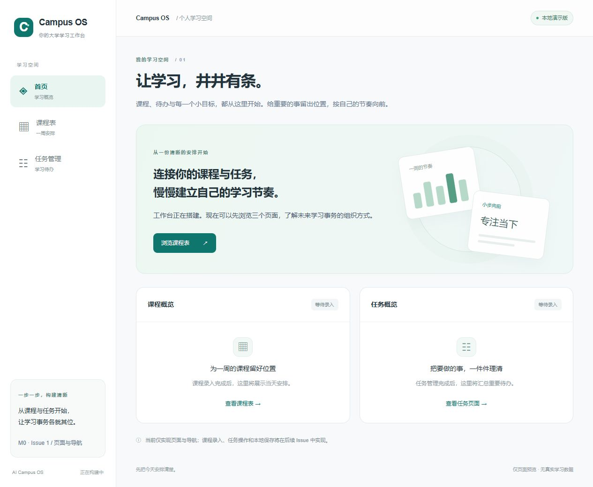

# AI Campus OS

面向大学生的个人学习工作台：把课程、通知和待办整理成可确认、可执行、可追踪的学习计划。

产品依据：[开发蓝图 v1.1](./AI_Campus_OS_Blueprint_v1.md)。

## 当前状态

**M0 / Issue 1：工程初始化与三页导航，等待人工验收。** 尚未完成整个 M0，也未发布版本。

已经实现：

- Next.js App Router + TypeScript 严格模式 + Tailwind CSS 工程。
- `/` 跳转到 `/dashboard`。
- 中文首页 `/dashboard`、课程表 `/timetable`、任务管理 `/tasks`。
- 共享桌面侧边栏、手机底部导航、当前页面高亮。
- 所有页面标注“本地演示版”，提供空白布局和后续能力说明。
- 系统字体、跳到主要内容链接、键盘焦点样式；课表区域支持横向滚动。

尚未实现：

- 课程和任务增删改查、筛选、完成状态。
- 教学周设置、周切换、截止时间计算。
- localStorage 或其他数据持久化。
- 登录、数据库、AI、通知、文件上传及平台同步。

**当前只有页面导航可操作。课表空白不代表真实空闲时间，页面没有真实课程或任务数据。**



## 本地启动

本项目在 Node.js `22.23.2`、npm `10.9.8` 环境下初始化，建议使用 Node.js 22 或更新的兼容 LTS 版本。

在仓库根目录执行：

```bash
npm ci
npm run dev
```

访问 <http://localhost:3000>。首次开发编译可能需要等待，按 `Ctrl+C` 停止服务。不需要环境变量、账号或 API Key。

如本机端口已被占用，可使用 `npm run dev -- --port 3001`。

## 本地检查与生产运行

```bash
npm run typecheck
npm run lint
npm run build
npm run start
```

`typecheck` 先生成 Next.js 路由类型再运行 TypeScript；`lint` 独立调用 ESLint；`start` 需要先完成生产构建。本轮没有引入单元测试或端到端测试框架。

本轮实际通过类型检查、零警告 Lint 和生产构建，并在浏览器检查三页导航与 375px 手机布局。Windows 沙箱内的 Next.js 路径解析曾被拒绝，类型检查和构建在获准的沙箱外运行通过。

依赖兼容说明：当前使用 Next.js 16.4.3、React 19.3.1、Tailwind CSS 4.3.3、TypeScript 6.0.3。Next.js 配套的 import 插件尚不兼容 ESLint 10，暂保留 ESLint 9.39.5；npm 对该版本有停止支持提示，后续需随上游插件兼容情况升级。安装审计当时报告 0 个已知漏洞，这不等同于永久安全保证。

## 目录与页面组织

```text
src/
  app/
    layout.tsx                 # 文档语言、元信息、全局样式
    page.tsx                   # 根路径跳转
    globals.css                # Tailwind 入口、共享样式和响应式规则
    (workspace)/
      layout.tsx               # 共享侧边栏、顶栏、底部导航、内容区
      dashboard/page.tsx       # 首页介绍及课程、任务入口
      timetable/page.tsx       # 空白周课表布局
      tasks/page.tsx           # 任务空状态和后续能力说明
  components/
    navigation.tsx             # 导航配置与当前页面高亮
    page-heading.tsx           # 页面标题与预览说明
```

`(workspace)` 只组织目录，不出现在 URL。只有导航组件因读取当前路径而使用客户端组件；页面及布局保持默认的服务端组件。没有共享业务状态、业务 API 或外部数据请求。

## 后续路线

按已确认方案逐个 Issue 推进：本地数据模型与保存 → 日期规则 → 课程管理与课表 → 任务管理 → 首页联动 → 体验与验收。整个 M0 验收通过后，才考虑 `v0.1.0`；数据库与账号属于 M1，AI 属于 M2。

## 学习与贡献记录

- 本轮开发及验证记录见 [LEARNING_LOG.md](./LEARNING_LOG.md)。
- 版本变化见 [CHANGELOG.md](./CHANGELOG.md)。
- `AGENTS.md` 由本次运行的 Next.js 开发服务器自动生成，提示后续 AI 开发先阅读已安装版本的本地文档。
- 代码由 Codex 辅助实现，项目负责人负责人工验收与后续学习记录。当前不声称已独立掌握相关技术。
- 不提交密钥、真实群聊或同学个人信息。当前保留原 Git 历史和开发蓝图；提交、推送、合并及发布需项目负责人明确授权。
