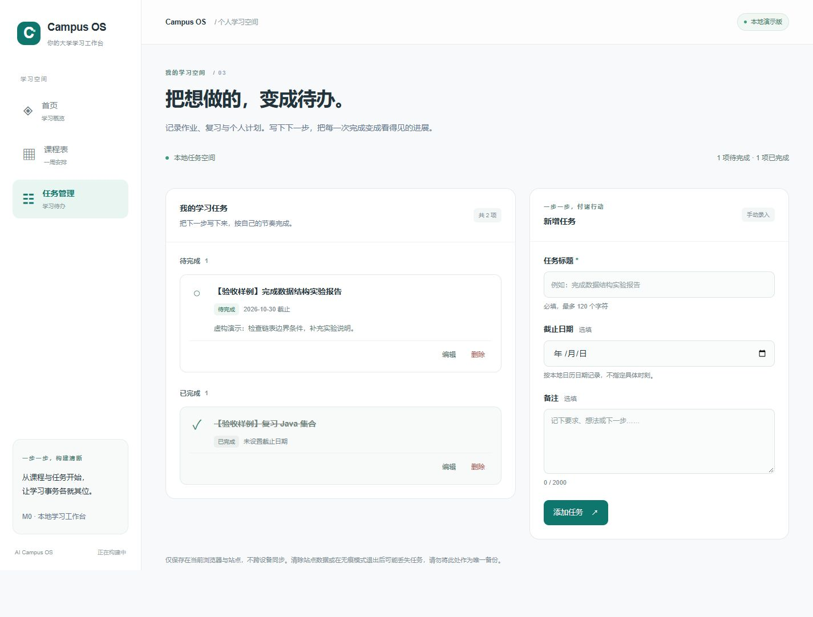

# AI Campus OS

面向大学生的个人学习工作台：把课程、通知和待办整理成可确认、可执行、可追踪的学习计划。

产品依据：[开发蓝图 v1.1](./AI_Campus_OS_Blueprint_v1.md)。

## 当前真实状态

**M0 / Issue #3：任务管理 CRUD 与本地持久化已实现，等待人工验收。** 整个 M0 尚未完成，未发布版本。

### 已实现

- Next.js App Router + TypeScript 严格模式 + Tailwind CSS 工程。
- `/` 跳转 `/dashboard`；中文首页、课程表、任务管理三页及桌面/手机导航。
- `/tasks` 新增、查看、编辑、完成、恢复未完成和删除确认。
- 标题必填（去除首尾空白，最多 120 个字符）；备注选填（最多 2000 个字符）；截止日期选填。
- 待完成与已完成分组、数量统计、空状态、字段错误提示和保存反馈。
- `localStorage` 持久化：刷新、离开再返回后读取已保存任务；首次使用不自动创建假任务。
- 版本化存储校验；损坏/不兼容数据阻止写入并允许下载原文备份；存储写入失败保留表单和已保存列表。
- 监听存储变化及窗口重新获得焦点，重新读取其他标签页的修改；写入前比较原数据，避免普通的过期覆盖；编辑时再次检查任务修订时间。
- 桌面双栏、手机单栏表单与列表；页面内原生 dialog 确认框，支持键盘焦点约束和 Escape 取消。

### 尚未实现

- 课程录入、教学周切换、课程关联，以及首页真实任务汇总。
- 搜索、筛选、优先级、提醒、排程和文件管理。
- 登录、云数据库、AI API、平台同步和多设备同步。
- 完整备份导入/自动修复、撤销删除和多标签页数据库事务。

首页与课表仍为相应范围的布局预览；课表空白不代表真实空闲时间。只有任务页已实现真实本地操作。

## 真实运行截图

以下任务由测试时通过表单手动录入，标题标注“验收样例”，不来自真实通知，也不是应用内置数据。



[375px 手机任务页完整截图](./docs/screenshots/issue-3-tasks-mobile.jpg)

## 本地启动

本轮环境：Node.js `22.23.2`、npm `10.9.8`。因新增 Vitest 5，支持 Node.js `^22.12.0 || ^24.0.0 || >=26.0.0`；建议使用兼容的 LTS 版本。

在仓库根目录执行：

```bash
npm ci
npm run dev
```

访问 <http://localhost:3000>，按 `Ctrl+C` 停止服务。无需环境变量、账号或 API Key。端口占用时：

```bash
npm run dev -- --port 3001
```

本轮验收生产预览使用 <http://127.0.0.1:3001/tasks>。`localhost`、`127.0.0.1`、不同端口及浏览器配置分别拥有自己的站点存储；换地址后看不到旧任务不代表原数据已删除。

## 检查与生产运行

```bash
npm run typecheck
npm run lint
npm test
npm run build
npm run start
```

`typecheck` 生成 Next.js 路由类型后运行 TypeScript；`lint` 独立运行 ESLint；`test` 以 Vitest 执行全部单元测试；`start` 需要先构建。没有引入端到端测试框架。

本轮实际结果：

- 类型检查、零警告 Lint、生产构建通过。
- Vitest：2 个测试文件，53 项测试全部通过，包含实际 React 服务端渲染测试。
- 浏览器：桌面与 375px 手机的新增、编辑、完成、恢复、删除确认/取消、刷新恢复、空白标题校验、空列表及原页面导航已检查。
- 存储损坏、权限失败、空间不足与普通标签页冲突使用自动化存储替身测试；未声称进行了真实浏览器空间耗尽或并发压力实验。
- Windows 沙箱存在 Next.js 路径解析限制，类型检查、构建及测试在获准的沙箱外执行。

## 代码组织与数据流

```text
src/
  app/
    layout.tsx                         # 中文文档、元信息、全局样式
    page.tsx                           # 根路径跳转
    globals.css                        # 共享及任务模块样式
    (workspace)/
      layout.tsx                       # 统一侧边栏、顶栏和手机导航
      dashboard/page.tsx                # 首页介绍与入口
      timetable/page.tsx                # 空白周课表预览
      tasks/page.tsx                    # 服务端页面骨架
  components/
    navigation.tsx                     # 路径高亮
    page-heading.tsx                   # 页面标题
  features/tasks/
    model.ts                           # Task 类型、日期/输入校验、不可变 CRUD
    storage.ts                         # 版本校验、读写、冲突检查
    store.ts                           # 初始化与保存成功后的状态发布
    use-tasks.ts                       # React 订阅和浏览器事件
    task-workspace.tsx                  # 组合组件及用户操作反馈
    task-form.tsx                      # 标题、备注、日期表单
    task-list.tsx                      # 分组列表
    confirmation-dialog.tsx            # 删除/放弃输入的确认框
tests/unit/
    tasks.test.ts                      # 模型、持久化及异常测试
    tasks-ssr.test.ts                   # 无 window 环境下的 SSR 测试
```

数据流：表单实际值 → 输入校验 → 任务操作 → 本地存储校验与写入 → 成功后发布新状态 → 列表更新。读写逻辑不依赖页面组件，后续可替换持久化实现。

React `useSyncExternalStore` 使用稳定的服务端“读取中”快照；在客户端订阅后才读 `localStorage`。初始化没有自动写回的 Effect，因此不会把空数组写入并覆盖旧任务。存储键为 `ai-campus-os:tasks:v1`，内容是 `{ schemaVersion: 1, tasks: [...] }`。

截止日期以 `YYYY-MM-DD` 日历字符串保存；同日未完成不算逾期，次日起算逾期。只用浏览器本地年月日比较，不将日期转成 UTC 时间戳；创建及修改时间另存 ISO 时间戳。表单提交使用 FormData 获取实际输入，避免原生日期框或自动填充事件时序导致漏存。

## 数据边界与故障处理

- 仅保存在当前浏览器与站点；清除站点数据、无痕模式退出或浏览器故障可能丢失数据，不应用作唯一备份。
- 保存成功表示浏览器 setItem 返回成功，不代表已经云备份。写入失败不会先更新列表或清空表单。
- 数据损坏/未知版本时，先下载原文备份，再人工排查；本轮没有一键清空或自动修复，避免丢弃无法识别的记录。下载内容保持原文，不冒充可直接导入的备份格式。
- 监听与写前比较可以发现常见标签页冲突；localStorage 的“比较再写入”没有原子性，极端同时写入仍有竞争窗口，不保证事务级并发。
- 表单切换任务或取消编辑时，有未保存输入会提示；直接刷新、离开页面或关闭浏览器不会保存草稿。请先点击添加任务或保存修改。
- 当前没有课程关联、首页汇总、用户权限或云同步；删除任务不可撤销，须先确认。

## 第三方方案与选型

沿用 Next.js 16.4.3、React 19.3.1、Tailwind 4.3.3、TypeScript 6.0.3。新增开发依赖 [Vitest 5.0.5](https://github.com/vitest-dev/vitest)（MIT），已核对 npm 元信息、包内许可证及 Node 兼容性；适配为 `npm test`、Node 环境单元测试和 SSR 测试，不增加产品运行时依赖。

存储与订阅采用浏览器 localStorage 和 React 自带 [useSyncExternalStore](https://react.dev/reference/react/useSyncExternalStore)；确认框采用浏览器原生 dialog，无需为当前范围引入数据库、状态管理库或整套 UI 组件库。本轮无第三方代码片段或图片的实质复制；依赖及其许可证由 npm 包与锁文件管理。

Next.js 配套 import 插件暂不兼容 ESLint 10，仍使用 ESLint 9.39.5（npm 有停止支持提示），后续随插件兼容情况升级。新增依赖安装时 npm 审计报告 0 个已知漏洞，该结果仅反映当次检查。

## 开发记录与路线

- 本轮依据：[Issue #3](https://github.com/Carlson-Xu/ai-campus-os/issues/3)。
- 验证基线：`feature/m0-task-management` 分支，起点 `9052ddc`，开始时与远程 main 一致、工作区干净。
- 设计与调试过程见 [LEARNING_LOG.md](./LEARNING_LOG.md)，变化见 [CHANGELOG.md](./CHANGELOG.md)。
- 后续按单个 Issue 推进课程表、首页联动等功能；整个 M0 验收后再考虑 `v0.1.0`。
- 代码、测试和文档由 Codex 辅助完成；许鑫负责产品要求与人工验收，个人独立练习另行记录。
- 不提交真实群消息、凭据或个人隐私。本轮未执行 Git Commit、Push、Merge 或 Release。
